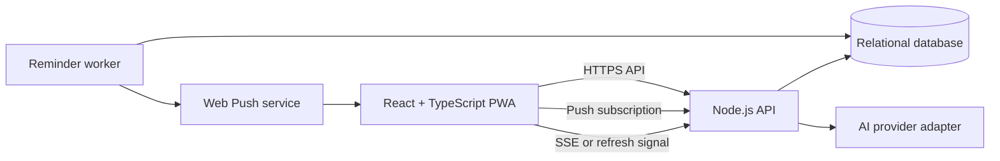

# Proposed Architecture Overview

**Status:** Proposal for discussion; not an implementation decision  
**Based on:** [Product brief](../product-brief.md)

## User-selected constraints

- Backend runtime: Node.js.
- Frontend: React with TypeScript; Next.js is not required.
- Keep the architecture solid and understandable for a portfolio. Apply Clean Architecture and SOLID where they reduce coupling or clarify responsibilities. Use CQRS only where it is justified.
- Prefer a component-based frontend organization; Atomic Design may be used as a vocabulary for reusable UI, not as a rigid folder taxonomy.
- The product is a responsive, installable PWA with cross-device event synchronization, scheduled push notifications, and AI-assisted calendar flows.

## Recommendation

Start with a **TypeScript modular monolith**: one React PWA, one Node.js API, one relational database, and a separately runnable reminder worker from the same backend codebase. Keep deployment units few and modules explicit. Do not introduce microservices, event sourcing, a distributed queue, or a separate read database for the MVP.

Use Clean Architecture pragmatically in the backend: domain rules do not depend on HTTP, database, AI provider, or push provider details. Organize around product modules first, and use ports/adapters at boundaries where provider or infrastructure changes are plausible.

## System shape



The PWA and API should preferably share an origin in production (for example, static app at `/` and API at `/api`). This simplifies secure cookie sessions and avoids unnecessary cross-origin authentication configuration. The exact hosting topology remains open.

## Backend modules and layers

Recommended feature modules:

- **Identity and Sessions:** username registration/sign-in, password hashing, per-device sessions, sign-out.
- **Calendar Events:** event validation and create/update/delete/list use cases.
- **Reminders:** durable reminder records, scheduling, delivery state, cancellation/rescheduling after event changes.
- **Push Subscriptions:** register and remove browser installation subscriptions for a calendar/user.
- **Assistant:** natural-language event drafts, calendar questions, and proposed changes; no direct model-to-database access.

Within a module, use these layers only where useful:

1. **Domain:** entities, value types, and business invariants. Keep framework-free.
2. **Application:** use cases/commands/queries and ports (repositories, clock, AI, push, transaction boundary).
3. **Infrastructure:** database repositories, password hashing, AI and Web Push adapters, background worker.
4. **Delivery:** HTTP controllers, request/response schemas, authentication middleware, and event stream endpoints.

Keep this as one deployable API initially. The reminder worker can be a second process using the same application and infrastructure modules; it should not become a separate service until load or operations justify that split.

## Frontend organization

Use feature-oriented components rather than a global `atoms/molecules/organisms` hierarchy:

```text
src/
  app/                 # routing, app shell, providers
  features/
    auth/
    calendar/
    events/
    assistant/
    notifications/
  shared/
    ui/                 # reusable primitives and composed components
    api/                # typed HTTP client and response schemas
    lib/                # formatting, date/time helpers
```

Within `shared/ui`, Atomic Design labels can help describe reusable visual complexity if the team finds them useful. Keep domain behavior in feature-level hooks/services, not in generic UI atoms. Avoid introducing global state until concrete cross-feature state requires it; server-owned calendar data should have a clear cache and invalidation strategy.

## Data and time model

A relational database is a good initial fit for unique usernames, ownership constraints, event edits, reminder idempotency, and transaction boundaries. PostgreSQL is a reasonable first-choice proposal, subject to deployment constraints; avoid locking a vendor or managed-hosting provider at this stage.

Candidate entities:

- `User`: unique canonical username and password hash.
- `Session`: one independently revocable record per device/browser installation; store a hash of the session secret rather than the bearer secret.
- `CalendarEvent`: owner, title, scheduled instant, creation time zone, timestamps, and a version for conflict detection.
- `PushSubscription`: user/session association, endpoint, cryptographic keys, and last-seen/expiration metadata.
- `ReminderDelivery`: event, reminder offset, due instant, status, attempt count, and idempotency key.
- `AssistantProposal`: user, action, target event/version, proposed fields, status, and expiry until user confirmation.

The product brief says to interpret the entered date/time in the creating device's local zone, while display behavior on a device in another zone is unresolved. The client should send an explicit IANA time-zone identifier along with local date/time. Before finalizing the event schema, decide whether events represent a fixed instant (recommended for reminders) and are displayed in each viewer's local zone, or preserve the original wall-clock time across zones. Handle ambiguous/nonexistent local times around daylight-saving transitions explicitly.

## API and synchronization

Use versioned, typed HTTP endpoints for ordinary reads and writes. Keep transport DTOs separate from domain entities. Validate all request bodies and authorization at the API boundary.

Candidate endpoint groups:

- `/api/auth/signup`, `/api/auth/login`, `/api/auth/logout`
- `/api/events` and `/api/events/:eventId`
- `/api/push-subscriptions`
- `/api/assistant/drafts`, `/api/assistant/questions`, `/api/assistant/proposals/:id/confirm`
- `/api/changes` for server-sent events (SSE), if the product expects connected devices to update immediately

For multi-device consistency, every mutation is committed in the database first. Connected clients can receive an SSE invalidation event and refetch the affected calendar range. If near-real-time updates are not required, refetch on app focus and after local mutations is simpler; confirm latency expectations before choosing. PWA push notifications are separate from SSE: SSE updates an open app, while Web Push can notify a subscribed installation when it is closed, subject to platform support and permission.

Use optimistic concurrency (for example, an event `version` or `updatedAt` precondition) so two devices editing the same event do not silently overwrite each other. The exact conflict UX can remain minimal in the MVP.

## Persistent per-device sessions

The product requirement is a session per device that survives restarts and ends on that device's explicit sign-out. `localStorage` should not be selected merely because it is easy: JavaScript executing on the origin can read it, so an XSS flaw can expose a stored session identifier. Prefer a random, server-validated session identifier in a persistent `Secure`, `HttpOnly`, `SameSite` cookie, with a server-side session row and explicit revoke-on-logout. This also supports one session per device without adding an account-wide logout feature.

The user prefers no automatic expiry. A truly non-expiring credential increases the impact of a lost/shared device and removes a recovery path. The design should make the trade-off explicit and at minimum support local logout and server-side revocation. Whether to add an absolute maximum lifetime, rotation, or a “remember this device” policy is an open product/security decision; do not silently override the user's no-expiry requirement.

Store passwords only as an adaptive password hash using a maintained password-hashing library and parameters reviewed at implementation time. No password complexity rule is needed to use a suitable hash. Apply rate limits to sign-in and sign-up to reduce username/password guessing and automated account creation.

## Reminder delivery

Do not schedule reminders with in-memory timers inside API requests; process restarts would lose them. When an event is created or rescheduled, transactionally upsert two durable `ReminderDelivery` records (10 minutes and 1 minute before). On deletion, cancel pending deliveries. A worker claims due rows safely, sends Web Push, and records the outcome. Use an idempotency key and a claim/lease or row-locking strategy so retries and multiple worker instances do not create duplicate sends.

If an event is created or edited after one or both reminder times have passed, define whether past reminders are skipped; recommended MVP behavior is to schedule only future reminders. Delivery remains best-effort: subscriptions expire, users can revoke permission, and browsers/platforms differ. Surface permission and delivery state clearly; do not claim guaranteed delivery.

## AI flows and boundaries

Put AI behind an application port so provider requests are isolated and replaceable. The provider adapter must not receive unrestricted database access or user sessions.

- **Natural-language event creation:** provide current local date/time and IANA time zone as explicit context; request structured title/date/time output; validate schema and domain rules; show a draft; save only after explicit confirmation.
- **Calendar questions:** query only the authenticated user's requested date range in application code, then send the minimum relevant event data to the model. Prefer deterministic answers for simple date/range lookups; use the model to interpret the question and phrase results. Clearly handle no results and ambiguous ranges.
- **Edit/delete proposals:** resolve target events in application code; create a proposal bound to the user and current event version; show a diff/preview; on confirmation, re-check authorization and version before applying. The model never executes mutations directly.
- Treat prompts, model output, event titles, and retrieved text as untrusted. Validate structured output and constrain tools to explicit use cases. Do not include passwords, session tokens, or unrelated event data in AI requests.
- Record outcome metadata for evaluation (request type, validation result, user confirmed/rejected, latency/error) while minimizing retained personal event content.

Do not choose a provider, model, prompt orchestration framework, or retrieval system before evaluating cost, latency, data handling, and structured-output capabilities against representative scenarios. No vector database or RAG system is justified by the current MVP scope.

## CQRS, SOLID, and complexity

- **CQRS:** Do not adopt full CQRS, event sourcing, or separate read/write models for this CRUD calendar. Keep explicit application commands and queries where that improves readability (for example, `CreateEvent`, `GetCalendarRange`, `DraftAssistantChange`). A separate read model is not needed now.
- **SOLID:** Apply dependency inversion at external boundaries (database, AI, push, clock) and keep modules cohesive. Avoid an interface for every class or a generic repository framework without a clear substitution/testing benefit.
- **Clean Architecture:** Use it to protect domain rules from infrastructure, but keep the project a modular monolith. Thin feature modules and clear use cases are a better portfolio signal than many layers with no behavior.
- **Atomic Design:** Use only as a UI collaboration vocabulary where helpful; organize the application by feature to keep calendar workflows together.

## Decisions to defer

- Node HTTP framework and TypeScript configuration for the backend.
- Relational database and hosting/deployment provider.
- AI provider/model and how representative quality examples will be evaluated.
- Web Push provider configuration, browser support matrix, and notification permission-denied UX.
- Final cross-time-zone display and daylight-saving behavior.
- Session lifetime policy beyond the user's current preference; localStorage vs cookie is not an open preference but a technical proposal requiring review.
- Whether synchronization must be immediate (SSE) or can refresh on app focus.
- Username normalization, length, allowed characters, and rate limits.

## Suggested Architecture Decision Records

Create an ADR under `docs/decisions/` when the corresponding option is chosen:

1. Backend framework, TypeScript, and modular monolith structure.
2. Database and durable reminder scheduling approach.
3. Persistent per-device session mechanism and no-expiry trade-off.
4. Time-zone storage and cross-device display rules.
5. PWA/Web Push and live synchronization strategy.
6. AI provider and constrained assistant interaction design.
