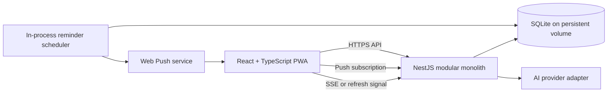

# Proposed Architecture Overview

**Status:** Architecture proposal; backend framework and database selected by the user  
**Based on:** [Product brief](../product-brief.md)

## User-selected constraints

- Backend runtime: Node.js.
- Backend framework: NestJS.
- Backend language: TypeScript.
- Database: SQLite; the user does not plan to scale the MVP.
- ORM: Prisma.
- Frontend: React with TypeScript; Next.js is not required.
- Keep the architecture solid and understandable for a portfolio. Apply Clean Architecture and SOLID where they reduce coupling or clarify responsibilities. Use CQRS only where it is justified.
- Prefer a component-based frontend organization; Atomic Design may be used as a vocabulary for reusable UI, not as a rigid folder taxonomy.
- The product is a responsive, installable PWA with cross-device event synchronization, scheduled push notifications, and AI-assisted calendar flows.

## Recommendation

Use a **TypeScript modular monolith**: one React PWA and one NestJS application backed by a SQLite database file on persistent storage. Run the durable reminder scheduler inside the same NestJS process. Keep deployment simple: one always-on application instance, one persistent volume, and a backup plan. Do not add a separate worker process, microservices, event sourcing, Redis, an external queue, or a separate read database for the MVP.

Use NestJS modules as feature boundaries and apply Clean Architecture pragmatically: domain rules do not depend on HTTP, SQLite, AI provider, or push provider details. Organize around product modules first, and use ports/adapters at boundaries where provider or infrastructure changes are plausible.

## Backend framework

**NestJS with TypeScript is selected by the user.** Its modules and providers support the requested structured, SOLID-informed backend. NestJS does not guarantee Clean Architecture: keep domain types and application rules independent of Nest decorators and HTTP concerns. Use Nest providers/controllers at the delivery and composition edges.

Do not add the Nest CQRS package for the initial CRUD calendar. Keep readable application commands and queries inside feature modules; reconsider CQRS only if read/write workflows materially diverge.

## System shape



The PWA and API should preferably share an origin in production (for example, static app at `/` and API at `/api`). This simplifies secure cookie sessions and avoids unnecessary cross-origin authentication configuration. The exact hosting topology remains open.

## Backend modules and layers

Recommended feature modules:

- **Identity and Sessions:** username registration/sign-in, password hashing, per-device sessions, sign-out.
- **Calendar Events:** event validation and create/update/delete/list use cases.
- **Reminders:** durable reminder records, scheduling, delivery state, cancellation/rescheduling after event changes.
- **Push Subscriptions:** register and remove browser installation subscriptions for a calendar/user.
- **Assistant:** natural-language event drafts, calendar questions, and proposed changes; no direct model-to-database access.

Within a module, use these layers only where useful:

1. **Domain:** entities, value types, and business invariants. Keep framework-free.
2. **Application:** use cases/commands/queries and ports (repositories, clock, AI, push, transaction boundary).
3. **Infrastructure:** database repositories, password hashing, AI and Web Push adapters, in-process reminder scheduler.
4. **Delivery:** HTTP controllers, request/response schemas, authentication middleware, and event stream endpoints.

Keep this as one deployable NestJS process. The reminder scheduler is a Nest provider/module that periodically claims due rows from SQLite and sends push notifications. It must not use per-event in-memory timers; a process restart should recover work from durable reminder rows. Avoid a second process against the same SQLite file: it adds deployment and locking complexity without MVP value.

## Frontend organization

Use feature-oriented components rather than a global `atoms/molecules/organisms` hierarchy:

```text
src/
  app/                 # routing, app shell, providers
  features/
    auth/
    calendar/
    events/
    assistant/
    notifications/
  shared/
    ui/                 # reusable primitives and composed components
    api/                # typed HTTP client and response schemas
    lib/                # formatting, date/time helpers
```

Within `shared/ui`, Atomic Design labels can help describe reusable visual complexity if the team finds them useful. Keep domain behavior in feature-level hooks/services, not in generic UI atoms. Avoid introducing global state until concrete cross-feature state requires it; server-owned calendar data should have a clear cache and invalidation strategy.

## Data and time model

**SQLite with Prisma ORM is selected by the user** because the MVP is not expected to scale. Target Prisma ORM v7 for SQLite: the official v7 documentation supports local SQLite files and migrations, while Prisma ORM 8 currently marks SQLite experimental. Recheck release status when dependencies are selected. [Prisma ORM v7 SQLite documentation](https://www.prisma.io/docs/orm/v7/core-concepts/supported-databases/sqlite) [Prisma ORM supported databases](https://www.prisma.io/docs/orm/supported-databases)

SQLite fits a small relational calendar and keeps deployment simple, provided it runs as a single application instance with a persistent disk and regular backups. SQLite supports concurrent readers but serializes writes; keep write transactions short, handle a busy/locked result with bounded retry, and avoid multiple app instances or a separate reminder worker sharing the file. Do not host the database on an ephemeral filesystem or a network filesystem without validating its locking/durability semantics.

The SQLite driver adapter and hosting provider are not selected. Use Prisma migrations from the first data-bearing increment and select an adapter with transaction support that works in the target runtime.

Candidate entities:

- `User`: unique canonical username and password hash.
- `Session`: one independently revocable record per device/browser installation; store a hash of the session secret rather than the bearer secret.
- `CalendarEvent`: owner, title, scheduled instant, creation time zone, timestamps, and a version for conflict detection.
- `RecurringEvent` and `RecurringOccurrence`: weekly rule plus persisted exceptions; normal occurrences are expanded on read ([ADR 0011](../decisions/0011-weekly-recurrence.md)).
- `PushSubscription`: user/session association, endpoint, cryptographic keys, and last-seen/expiration metadata.
- `ReminderDelivery`: event, reminder offset, due instant, status, attempt count, and idempotency key.
- `AssistantProposal`: user, action, target event/version, proposed fields, status, and expiry until user confirmation.

The user decided that events are fixed instants displayed in each viewer's local time zone, while the creating device's IANA time zone is kept as provenance. See [ADR 0004](../decisions/0004-event-time-zone.md). The client converts local date/time input to an ISO instant with an explicit offset; the API stores and queries the instant in UTC. Daylight-saving ambiguous/nonexistent input times are resolved by the browser's `Date` conversion in the MVP. Calendar ranges are half-open intervals, and the week starts on Monday. Weekly recurrence adds a rule plus exception rows and expands occurrences on read, as recorded in [ADR 0011](../decisions/0011-weekly-recurrence.md).

## API and synchronization

Use versioned, typed HTTP endpoints for ordinary reads and writes. Keep transport DTOs separate from domain entities. Validate all request bodies and authorization at the API boundary.

Candidate endpoint groups:

- `/api/auth/signup`, `/api/auth/login`, `/api/auth/logout`
- `/api/events` and `/api/events/:eventId`
- `/api/push-subscriptions`
- `/api/assistant/drafts`, `/api/assistant/questions`, `/api/assistant/proposals/:id/confirm`
- `/api/changes` for server-sent events (SSE), if the product expects connected devices to update immediately

For multi-device consistency, every mutation is committed in the database first. Connected clients can receive an SSE invalidation event and refetch the affected calendar range. If near-real-time updates are not required, refetch on app focus and after local mutations is simpler; confirm latency expectations before choosing. PWA push notifications are separate from SSE: SSE updates an open app, while Web Push can notify a subscribed installation when it is closed, subject to platform support and permission.

Use optimistic concurrency (for example, an event `version` or `updatedAt` precondition) so two devices editing the same event do not silently overwrite each other. The exact conflict UX can remain minimal in the MVP.

## Persistent per-device sessions

The product requirement is a session per device that survives restarts and ends on that device's explicit sign-out. `localStorage` should not be selected merely because it is easy: JavaScript executing on the origin can read it, so an XSS flaw can expose a stored session identifier. Prefer a random, server-validated session identifier in a persistent `Secure`, `HttpOnly`, `SameSite` cookie, with a server-side session row and explicit revoke-on-logout. This also supports one session per device without adding an account-wide logout feature.

The user prefers no automatic expiry. A truly non-expiring credential increases the impact of a lost/shared device and removes a recovery path. The design should make the trade-off explicit and at minimum support local logout and server-side revocation. Whether to add an absolute maximum lifetime, rotation, or a “remember this device” policy is an open product/security decision; do not silently override the user's no-expiry requirement.

Store passwords only as an adaptive password hash using a maintained password-hashing library and parameters reviewed at implementation time. No password complexity rule is needed to use a suitable hash. Apply rate limits to sign-in and sign-up to reduce username/password guessing and automated account creation.

## Reminder delivery

Do not schedule reminders with per-event in-memory timers; process restarts would lose them. When an event is created or rescheduled, transactionally upsert two durable `ReminderDelivery` rows (10 minutes and 1 minute before). On deletion, cancel pending deliveries. A single in-process scheduler polls for due rows, claims one in a short SQLite transaction, sends Web Push outside the transaction, then records the outcome. Use a unique event/offset key and bounded retries; with SQLite and one app instance, no external queue or distributed lock is needed.

Delivery is at-least-once in rare crash windows (for example, the process can stop after a push is accepted but before the row is marked sent), so a duplicate push cannot be ruled out. Keep this limitation visible rather than introducing queue infrastructure for the MVP.

If an event is created or edited after one or both reminder times have passed, define whether past reminders are skipped; recommended MVP behavior is to schedule only future reminders. Delivery remains best-effort: subscriptions expire, users can revoke permission, and browsers/platforms differ. Surface permission and delivery state clearly; do not claim guaranteed delivery. For recurring series, reminder rows are generated inside a rolling 48-hour horizon and refreshed by the same scheduler; see [ADR 0011](../decisions/0011-weekly-recurrence.md).

## AI flows and boundaries

Put AI behind an application port so provider requests are isolated and replaceable. The provider adapter must not receive unrestricted database access or user sessions.

- **Natural-language event creation:** provide current local date/time and IANA time zone as explicit context; request structured title/date/time output; validate schema and domain rules; show a draft; save only after explicit confirmation.
- **Calendar questions:** query only the authenticated user's requested date range in application code, then send the minimum relevant event data to the model. Prefer deterministic answers for simple date/range lookups; use the model to interpret the question and phrase results. Clearly handle no results and ambiguous ranges.
- **Edit/delete proposals:** resolve target events in application code; create a proposal bound to the user and current event version; show a diff/preview; on confirmation, re-check authorization and version before applying. The model never executes mutations directly.
- Treat prompts, model output, event titles, and retrieved text as untrusted. Validate structured output and constrain tools to explicit use cases. Do not include passwords, session tokens, or unrelated event data in AI requests.
- Record outcome metadata for evaluation (request type, validation result, user confirmed/rejected, latency/error) while minimizing retained personal event content.

Do not choose a provider, model, prompt orchestration framework, or retrieval system before evaluating cost, latency, data handling, and structured-output capabilities against representative scenarios. No vector database or RAG system is justified by the current MVP scope.

## CQRS, SOLID, and complexity

- **CQRS:** Do not adopt full CQRS, event sourcing, or separate read/write models for this CRUD calendar. Keep explicit application commands and queries where that improves readability (for example, `CreateEvent`, `GetCalendarRange`, `DraftAssistantChange`). A separate read model is not needed now.
- **SOLID:** Apply dependency inversion at external boundaries (database, AI, push, clock) and keep modules cohesive. Avoid an interface for every class or a generic repository framework without a clear substitution/testing benefit.
- **Clean Architecture:** Use it to protect domain rules from infrastructure, but keep the project a modular monolith. Thin feature modules and clear use cases are a better portfolio signal than many layers with no behavior.
- **Atomic Design:** Use only as a UI collaboration vocabulary where helpful; organize the application by feature to keep calendar workflows together.

## Decisions to defer

- SQLite driver adapter and migration workflow details.
- Hosting/deployment provider; it must supply an always-on process, persistent disk, and backup path.
- AI provider/model and how representative quality examples will be evaluated.
- Web Push provider configuration, browser support matrix, and notification permission-denied UX.
- Portability of browser-specific daylight-saving input normalization across devices.
- The user-selected session behavior is no automatic expiry with independent logout per device. Any proposed change to expiry behavior needs a product decision; the mechanism for secure persistence still requires architecture review.
- Whether synchronization must be immediate (SSE) or can refresh on app focus.
- Username normalization, length, allowed characters, and rate limits.

## Architecture Decision Records

The user-selected backend framework and database are recorded in:

- [`0001-nestjs-backend.md`](../decisions/0001-nestjs-backend.md)
- [`0002-sqlite-database.md`](../decisions/0002-sqlite-database.md)
- [`0003-prisma-orm.md`](../decisions/0003-prisma-orm.md)
- [`0004-event-time-zone.md`](../decisions/0004-event-time-zone.md) for the selected event instant and viewer time-zone display rule.
- [`0011-weekly-recurrence.md`](../decisions/0011-weekly-recurrence.md) for rule expansion, occurrence exceptions, DST adjustment, reminder horizon, and two-level versioning.

Create further ADRs if implementation requires a decision on sessions, time-zone semantics, push/synchronization, or the AI provider.
